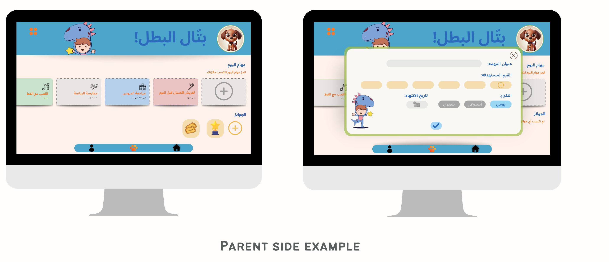
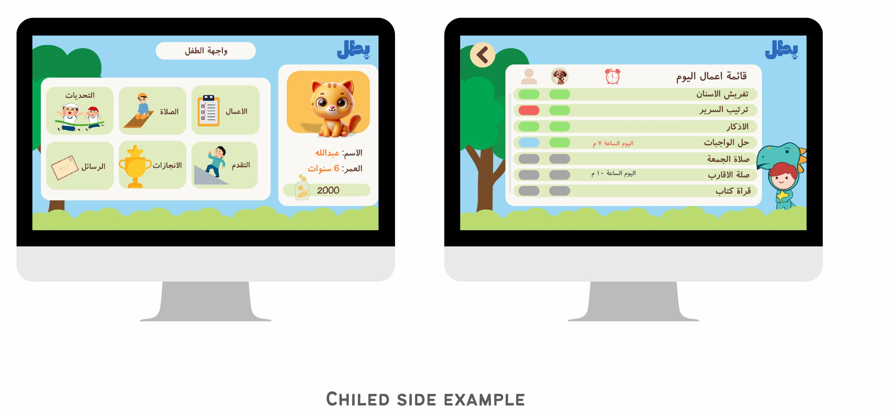

# BVN – Batal Value Nest (بطل)

> A gamified, Arabic-first habit and values tracker that helps children aged 6–9 build good habits through tasks, coins, avatars and rewards, with parents in the loop.



## Overview

Most habit-tracking apps for kids focus on routines and target English-speaking audiences. **BVN (Batal Value Nest)** was designed for Arabic-speaking families and ties everyday tasks to core values. The built-in values are perseverance (المواظبة), responsibility (المسؤولية), cleanliness (النظافة), kindness (العطف), altruism (الإيثار), honesty (الصدق) and generosity (الكرم).

Parents create an account, add their children, assign built-in or custom tasks linked to a value, and send rewards and encouraging messages. Children complete tasks, earn coins, pick an avatar and follow their own progress.

This repository holds the **PHP + MySQL backend** (REST-style endpoints that return JSON) and the **database schema**. The client app was built in **Unity (C#)** as a separate project. It is not included here.

> 🎥 A demo video of the full app (Unity client + this backend) is available on request.

## Features

- **Parent accounts:** sign up and log in. Passwords are hashed with `password_hash` and checked with `password_verify`, and sessions are PHP-based.
- **Child profiles:** add children with a name, age and a predefined avatar (Rabbit, Dog, Cat, Bird).
- **Value-based tasks:** a built-in library of 34 Arabic tasks grouped under 7 values. Parents can also add custom values and tasks.
- **Scheduling:** assign tasks to a child with a duration and deadline, then track daily task state.
- **Rewards and coins:** children earn coins, and parents send custom rewards with an icon and a reason.
- **Messages:** parents send short encouragement messages to a child.
- **JSON API:** every endpoint returns JSON for the Unity client.

## Tech Stack

| Layer | Technology |
|------|------------|
| Client app | Unity (C#), Visual Studio *(separate project, not in this repo)* |
| Backend | PHP 8 (mysqli, prepared statements) |
| Database | MySQL / MariaDB (exported from phpMyAdmin) |
| Local server | XAMPP (Apache + MariaDB) |

## Screenshots

| Parent side | Child side |
|---|---|
|  |  |

Project documentation (student IDs removed):
- Final report: [`docs/BVN_Final_Report.pdf`](docs/BVN_Final_Report.pdf)
- Presentation: [`docs/BVN_Presentation.pdf`](docs/BVN_Presentation.pdf)
- Poster: [`docs/BVN_Poster.pdf`](docs/BVN_Poster.pdf) / [`docs/poster.jpg`](docs/poster.jpg)

## Getting Started (XAMPP)

1. Install [XAMPP](https://www.apachefriends.org/) and start **Apache** and **MySQL**.
2. Create the database:
   - Open phpMyAdmin at `http://localhost/phpmyadmin`.
   - Create a database named `bvn` with collation `utf8mb4_general_ci`.
   - Import [`database/schema.sql`](database/schema.sql).
3. Deploy the backend. Copy the contents of `backend/` into `C:\xampp\htdocs\BVN\`, or `/Applications/XAMPP/htdocs/BVN/` on macOS. The avatar and icon URLs stored in the database expect the `/BVN/` path.
4. Configure the database connection:
   ```bash
   cp backend/config.example.php backend/config.php   # inside htdocs/BVN
   ```
   Edit `config.php` with your DB user and password. On a default XAMPP install that is `root` with an empty password.
5. Test an endpoint, for example `http://localhost/BVN/getValues.php`, which should return the list of values as JSON.
6. Point the Unity client's base URL to `http://<your-ip>/BVN/`.

## API Endpoints (summary)

| Endpoint | Method | Purpose |
|---|---|---|
| `signup.php` / `login.php` / `logout.php` | POST | Parent registration, login and logout |
| `fetch_users.php` | GET (session) | Logged-in parent's profile |
| `add_child.php`, `insert_child.php` | POST | Add a child profile |
| `fetch_children.php` | GET (session) | List the parent's children with avatars |
| `get_child.php`, `get_child_details.php`, `child_home.php` | GET/POST | Child details, coins and avatar |
| `getValues.php`, `custom_values.php` | GET/POST | List values or add a custom value |
| `add_task.php`, `add_task_with_value.php` | POST | Add a task, optionally with a new value |
| `saveScheduled.php`, `saveCScheduled.php`, `getScheduled.php` | POST/GET | Schedule tasks and list them |
| `getTasks.php`, `fetch_tasks.php`, `updateTaskState.php` | POST | A child's daily tasks and completion state |
| `send_reward.php`, `get_rewards.php`, `update_coins.php` | POST/GET | Rewards and coins |
| `send_message.php`, `get_messages.php` | POST/GET | Parent → child messages |
| `get_avatar.php`, `update_avatar.php` | GET/POST | Avatar lookup and update |

## Project Structure

```
batal-value-nest/
├── backend/
│   ├── config.example.php   # copy to config.php (git-ignored)
│   ├── db_connect.php       # loads config.php and opens the mysqli connection
│   ├── *.php                # API endpoints (see table above)
│   ├── Icons/               # reward icons
│   └── images/avatars/      # child avatars
├── database/
│   └── schema.sql           # tables + reference data (values, tasks, icons)
└── docs/
    ├── BVN_Final_Report.pdf
    ├── BVN_Presentation.pdf
    ├── BVN_Poster.pdf
    ├── poster.jpg
    └── screenshots/
```

## Notes

- `database/schema.sql` keeps the full table structure plus the reference data (values, built-in tasks, icons). The test accounts and sample child, message, reward and schedule rows from the development dump were removed.
- Some endpoints are prototypes. A few still build SQL with string interpolation (`add_task_with_value.php`, `saveCScheduled.php`), and `update_avatar.php` targets columns that are not in the final schema. Hardening them with prepared statements is the natural next step.
- Future work listed in the report: AI-powered task recommendations, a larger cultural values library, and community challenges.

## Team & Credits

Graduation project (CSAI-461, Final Year Project in Computer Science) at the **Department of Computer Science and Artificial Intelligence, College of Computing, Umm Al-Qura University**, 2024–2025.
Team **Hero Builders**: Hala Jalal, Khadijah Gheliwi, Shaima Al-Khuzaee and Mawaddah Dehlawi. Supervised by Dr. Elham Mahjoob Hassanain.

Team university graduation project. **Hala Jalal** contributed as a member of Hero Builders (CSAI-461).

## License

[MIT](LICENSE) © 2025 Hala Jalal
